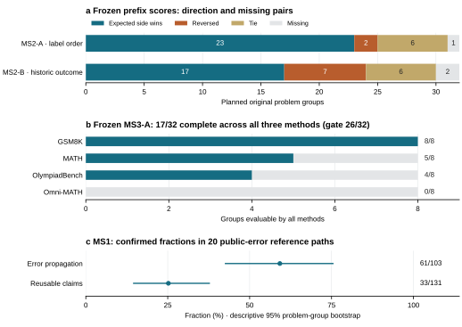

# Motivation Study v1.0｜阶段报告

2026-11-25（北京时间） · [研究入口 #28](https://github.com/RUSS0718/RiCL-experiemnt/issues/28) · [集成 PR #27](https://github.com/RUSS0718/RiCL-experiemnt/pull/27)

**阶段收口，不是整项研究通过。** 首批 MS2-A 可支持样本内的评分局限；MS2-B 提供历史终答关联的方向性证据。MS3-A 首批覆盖不足，不能比较三方法。新 MS3-A、MS3-B 和可选 MS2-B 均未派发，不存在新配置效应估计。旧 Pilot 的失败保留，不启动 Main Experiment。

## 结果总览

| 切片 | 计划原题组与实际覆盖 | 可以报告的结果 | 本批已知费用及缺失 |
| --- | --- | --- | --- |
| #29 MS1 | 30/30 个 ProcessBench 原题组、60/60 份双盲标注；23 条第三盲审 | 公开含错层：确认传播 61/103（59.2%）；可复用 33/131（25.2%） | 新研究 API 0；Agent 复核单列 |
| #32 MS2-A，首批复算 | 31/32 对；ProcessBench 各子集 4/4，PRM800K 15/16 | 未标错侧胜 23、含错侧胜 2、平 6；反转 2/31，6.5%（精确 95% CI 0.8%–21.4%）；含错侧高分（2 或 3）5/32，15.6%（5.3%–32.8%） | 历史 64 次：USD 0.0573039 本地估算；1 个左侧截断失配；本夜 0 |
| MS2-B，首批；#33 新复验 | 首批 30/32 对；GSM8K/MATH/OlympiadBench/Omni-MATH 依次 8/8、7/8、8/8、7/8。新批计划 64，实际 0，未冻结付费题单 | 首批 17 胜、7 负、6 平，平局计半 66.7%（按来源分层的配对 bootstrap 95% 区间 51.7%–80.0%）；非平局双侧精确 p=0.064。新批无结果 | 历史 64 次：USD 0.0588441；2 条截断，1 条计量细分越界；本夜 0 |
| #30 MS3-A，首批与校准 | 首批三方法共同 17/32（低于 26/32）；来源依次 8/8、5/8、4/8、0/8；含错 14/24、无错 3/8。新校准计划 4、独立复验计划 32，均未运行 | 只报覆盖；不比较首错命中、无错识别或偏移。不将未运行记成未命中 | 历史 96 次：USD 0.1506642 已知估算；27 条耗尽空正文、1 条截断有正文、3 条 HTTP 524 用量未知；本夜 0 |
| #31 MS3-B，新困难层 | 原 16 个与 12 个同层备选经核验，入围 16/16（8+8）；四臂实际 0/64 次 | 资格是离线发现；没有新 Oracle 对照效应 | 本夜 0；路由止损，不将未发送记成修复失败 |

首批另有 1 次合成隔离验证。共 225 次发送，已知输入/输出 118,501/192,953，报告推理 181,737 Token；历史本地估算 USD 0.2670939（不等于实扣）。3 次 524 未回用量，18 条推理细分大于总输出，记录不改写、不从旧预算释放。模型为 AIGCPro `deepseek-v4.1-flash`，显式思考、非流式 JSON、2,048 输出 Token、零重试。

## 来源分层

下表依次给出胜/负/平，胜表示 MS2-A 未标错侧更高、MS2-B 历史正确侧更高。缺失不计为平局。

| 数据来源 | MS2-A 可配对；胜/负/平 | MS2-B 可配对；胜/负/平 |
| --- | --- | --- |
| GSM8K | 4/4；3/1/0 | 8/8；6/0/2 |
| MATH | 4/4；3/1/0 | 7/8；4/2/1 |
| OlympiadBench | 4/4；2/0/2 | 8/8；4/2/2 |
| Omni-MATH | 4/4；4/0/0 | 7/8；3/3/1 |
| PRM800K Phase 2 test | 15/16；11/0/4 | 未纳入 |

### MS2-A：整体评分多数同向，仍会给明确错误高分

有效含错侧没有缺失，分母是 **32 个有效含错侧评分**，不是 31 个完整对或 64 条前缀。四个 ProcessBench 子集高分为 1/4、1/4、0/4、0/4；PRM800K 为 3/16。ProcessBench 用公开首错相对截点的位置；PRM800K 用与生成步骤对齐的 `−1` 标签。两者都不把「未标错」当作完整证明已核验。冻结主分析不因个案复核而重分类。

| 核验定位（冻结配对从 1 起） | 数学检查与限定 |
| --- | --- |
| A · ProcessBench GSM8K，第 2 对，含错 3 / 未标错 2 | 含错侧第 5 段把 `20−13` 写成 `6`；准确值是 `7`。未标错侧只算到总价 `13`。错误一侧已在可见前缀给出所求数值；该对既是明确高分含错，也暴露自然语言终答筛查的漏检。 |
| B · ProcessBench MATH，第 8 对，含错 1 / 未标错 0 | 含错侧第 3 段把 `(5ac)(6ab)` 写成 `30abc`，漏掉一个 `a`；应为 `30a²bc`。未标错侧在截点内仅重述题目、没有实质推导。「等段数」不是「等进展」，此反转不等同于偏好错误而非等质量证明。 |
| C · PRM800K，第 19 对，含错 2 / 未标错 2 | 含错侧第 5 段在 `n=3` 时把缺失角算成 `−470°`，代入公式应为 `−890°`。「该候选不可能」仍成立，不说明算式有效。未标错侧仅建立关系式；可独立用 `0<x<180°` 推出 `n=8`。 |

三例均经独立 Agent 盲审及本地 Python/SymPy 精确复算，评阅只看两侧可见前缀、不看分数和标签。盲审与工具复核分开归档。公开标签给出配对参考，案例只支持列出的数学范围，不能外推错误类别分布或证明 Evidence-based Rater 优于此模型。

### MS2-B：历史分数不等于在线增益

同题、同截点各取一条历史终答正确/不正确的完整轨迹；评分输入不带终答字段，资格筛查排除了显式答案标记，但不能保证隐含答案均被屏蔽。标签是终答状态而不是完整证明有效。观察到同向排序，非平局检验对机会水平的证据不足。bootstrap 只重抽已可配对的原题组，不修正选择偏差，也不是零假设的检验。把两个缺失对分别全作负或全作胜，32 组固定分母上的一致率界限为 62.5%–68.8%。这不是在线续推成功概率，也不是 APRS 的因果收益。新 64 对复验冻结条件为统一路由、每组两次评分、至少 52/64 可评，当前路由未放行；不能以首批区间代替复制证据。离线按原筛查规则、额外扣除首批与 MS3-B 整个备用池后，ProcessBench 四来源形状合格容量为 3/13/132/14（共 162 个互斥组）；只说明池子足够，但无法各取 16。未建立新冻结分配或发送。

### MS3-A：失配按来源与方法集中

| 诊断方法 | 可评/计划 | 耗尽空正文 | 截断有正文 | 524 |
| --- | ---: | ---: | ---: | ---: |
| Direct Judge | 21/32 | 10 | 0 | 1 |
| Critic | 23/32 | 7 | 1 | 1 |
| Reflection | 21/32 | 10 | 0 | 1 |

Omni-MATH 三方法分别 1/8、1/8、2/8 可评，17/24 次耗尽后空正文。没有证据表明不可评近似随机。下一校准仍要求四来源各一、至少 3/4 题组三方法全可评且 Omni-MATH 完整，证实用量口径后才放行与校准隔离的 32 组，不得补写旧 17/32。 离线排除首批、旧样本、近重复及 MS3-B 整个备用池后，现有快照在形状与分层上支持互斥的 4 组校准和 32 组复验；仅确认容量，未冻结题单或运行参数。

### MS1：依赖传播与可复用结论

**Finding。** 在 20 个公开含错的 ProcessBench 原题组中，盲标确认首错传播到 **61/103** 个后续节点（59.2%，描述性 95% 区间 42.4%–75.6%）；**33/131** 个非平凡去重命题至少有一条可核验、不依赖已知失效节点或未决依赖边的推导（25.2%，14.4%–37.9%）。传播深度取从首错沿确认边可达的最短路径：61 个节点中位 2 条边，四分位范围 1–3，最大 9；完整深度计数为 1–9 层依次 19、16、12、5、3、2、2、1、1。传播分母含所有确认首错之后的节点；未确认的边不计为已传播，因此这是确认比例，不是完整污染率。没有后续节点的轨迹不纳入传播分母。

| 公开参考分层 | 轨迹覆盖；传播可评 | 确认传播 / 首错后节点 | 可复用 / 非平凡命题 |
| --- | --- | --- | --- |
| 含错 | 20/20；20/20 | 61/103（59.2%） | 33/131（25.2%） |
| 无错 | 10/10；1/10 | 0/4，仅来自一条被 Agent 判有首错的轨迹，不做层级结论 | 40/46（87.0%；描述性 95% 区间 71.2%–100%） |
| 合计 | 30/30；21/30 | 61/107（57.0%；40.0%–73.7%） | 73/177（41.2%；28.4%–56.0%） |

**一致性与证据边界。** 两份原始盲标首错（状态及位置）一致 29/30，数学有效性一致 217/228；两方至少一方未排除的边仅一致 126/242（52.1%），包含双方排除的全部候选边为 870/986，不能只用较高的后一数字。23 条实质分歧轨迹均由第三 Agent 独立盲审；仍有 22 条边及 2 项等价归组未决，保留未知或不合并。共判 21 条有首错、9 条无错；15 条首错位置与公开标签一致，9 条无错判断与标签一致，另外 6 条保留差异。不把模型评阅共识当作金标准或人工签核，也不把对同一模型评阅的原题组 bootstrap 当作评阅偏差校正。未运行任何重推；重推成本及 Token 节省不可估计。

两个单独的算术核验用于定位机制，不参与盲标投票：

- **独立可复用。** 第 3 批第 9 条橙子轨迹 `s002` 的 `25×20%=5` 独立有效。`s004` 漏掉 2 个酸的橙子，将最终计数写成 19；按题意应为 `25−1−5−2=17`。可复用的是 `5`，不是最终计数；若首错在末段，不把该轨迹记作零传播来填充分母。
- **正确算术不能挽救错误前提。** 第 3 批第 4 条订阅轨迹 `s001` 的 `6×8=48` 可保留。`s002` 将常规价 8 个月误作 2 个月；`s004` 消费了错误时段导出的费用。`48+24+70=142` 算术正确，但不是正确费用推导；按题意应为 `48+8×12+10×14=284`。只核验这组算术与可见因果依赖，不推断实际节省 Token。

### MS3-B：资格核验不等于修复效果

**资格通过，效果不可得。** 对首批 16 个困难候选和 12 个已审同层备选，均要求独立参考解、精确首错、以及至少一项首错前的实质有效结论。按冻结的同层排序，仅使用填满各层所需的最早合格备选，不让两层互借，不把多余合格备选算进 16 组。入围来源为 GSM8K/MATH/OlympiadBench/Omni-MATH = 2/3/7/4；尚未冻结四臂有效运行参数，也未派发。

| 长度层 | 原 8 个：合格 / 不合格 / 待定 | 备选审核：合格 / 不合格 | 实际纳入原候选 / 备选 |
| --- | --- | --- | --- |
| 下层 | 4 / 3 / 1 | 5 / 3 | 4 / 4 |
| 上层 | 6 / 2 / 0 | 4 / 0 | 6 / 2 |

下层原待定题的补充独立核验未得到完整参考解，未用于补位。下层备选第 6 位的轨迹按非负整数点倍计数；仅在二次型值为 1 时就遗漏混合符号，实际 6 点、所用倍计数仅 4 点，因此公开较晚位置不能当首错。第 7 位经独立对数代换核出两个精确解，并确认实质错误首先出在把准确的对数常数换成错误近似值；按排序入围。第 8 位也合格，但不挤掉先到的合格项。数学工具复算只支持其中明确的整数计数和代数恒等式，轨迹首错与合格判断仍记为 Agent 证据。

后续若路由能放行，才在同题四臂中比较 G3−G1、G3−G2、G1−G0 及共同覆盖（预设每个主对照至少 13/16 可配对）。G3 只检验 Oracle 首错位置的作用，不代表自主诊断有效。当前可配对 0/16；没有修复率、错误移除、新错、保留率或成本差的估计，也不是零效应。

## 可复算图表



**图 1。** (a) 32 组固定分母，缺失独列，不计为平局。(b) 三方法共同可评，不是诊断准确率。(c) MS1 公开含错层，点旁为真实分母，区间按原题组重抽，不按节点重抽。

## 运行边界与账本

| 派发分项 | 发送上限 | 新实际发送 / 新已知费用 | 处置 |
| --- | ---: | --- | --- |
| #30 MS3-A 隔离校准 | 12 | 0 / USD 0 | `blocked`：无法核实逐请求最坏收费及推理账目 |
| #30 MS3-A 独立复验 | 96 | 0 / USD 0 | `blocked`：未通过前置校准，不能派发 |
| #31 MS3-B 四臂 | 64 | 0 / USD 0 | `blocked`：共同路由守卫；不以离线资格代替在线证据 |
| #33 MS2-B 新复验，可选 | 128 | 0 / USD 0 | `skipped`：路由不可靠且 P0 未解除 |

#28 运行窗口：2026-11-25 22:04:53 至 2026-11-26 06:04:53（北京时间），最多 8 小时；合计至多 300 次、USD 5.00、历史累计硬上限 USD 110，在线默认并发 1。历史 v2 的 USD 19.9904472 是当时的守卫占用，不是更新后的累计账单或可用余额。本夜只读取定价、状态和配额元数据，不访问推理 endpoint；未激活任何付费预留。供应商返回公开模型费率倍率，但当前凭证为不限额配额；无法证明当前组的完整有效费率、未知失败/推理的计费上界或输出约束。首批的 18 条计量不一致也是停止依据。无新模型发送，自然没有本夜的新未知受理或账款。保留旧未知和旧 8/5/5 的 0/0/0；不把正常测试当作研究结果。

**离线 Agent 单列。** 有可核查运行时长的 7 项子任务累计约 3.21 个子智能体小时，其中 0.85 小时为未得完整参考解的补充尝试。按任务墙钟求和，并行时段会重叠，不是本轮实耗墙钟。原有工件没有完整的历史子任务计时；完整 Agent 工时及独立货币成本不可得，不与研究 Provider 的 USD 0 混算。

## 数据、隔离与离线复现

- 首批实验仓基线 `abd3cf1a3e93fe942d2135ef28cb2795b3ea350d`，抽样种子 `20261125`。四个 ProcessBench 快照固定在修订 `3bdcd5371ed567559a78f559c01c13a6deee7604`；PRM800K Phase 2 test 固定在 `7ecc794703b2877f63226f2477a49b34f9b25163`。快照摘要、13 份 SQLite 台账、模型参数、盲键及供应商回执留在本地。此轮没有调用或修改 RiCL 主仓 Runtime，不伪填主仓运行 SHA。
- 历史可行性独立归档：[旧 Pilot 审计](pilot-offline-audit.md)、[MS2 v2](ms2-v2-validation-report.md)、[v3 开发](ms2-v3-calibration-decision.md)、[MS3 旧修复](ms3-pilot-blind-review.md)。修订首批不与其合并，也无新配置数据可合并。
- `main-study-holds.json` 按源文件哈希追溯旧 Pilot、开发、校准、隔离与留出清单，再加新版 142 个互斥组及 12 个已评阅备选（最终 2,228 个排除键，其中 2,074 个为历史键）。包含哈希/ID 别名和预留，条目数不是唯一题数；不得当作 Main Experiment 入选清单。合成校准探针另列；Main Experiment 冻结时还须在目标池重新检查跨库疑似重复。具体轨迹、盲标、原题组映射、账单及任何凭证不纳入 Git。
- 首批 `ms2-a`/`ms2-b` 为同题原题组单位。二项比例用 Clopper–Pearson；MS2-B 另外报告 20,000 次、种子 `20261125`、来源内重抽对的百分位区间。MS3-A 仅报告预先规定的覆盖。MS1 描述性区间同样使用 20,000 次原题组重抽、冻结研究种子 `20261125`，不把节点当独立样本，也不涵盖模型评阅偏差。

从实验仓根运行；输出参数必须指向尚不存在的目录。先确保测试临时清单不在 `artifacts/` 或 `data/` 的历史资料扫描范围，再按下列命令离线复算。这些命令不会发送模型请求：

```powershell
$env:PYTHONUTF8 = '1'
$frozen = 'artifacts/motivation-eligibility-20261125-proposal'
$night = 'artifacts/motivation-night-20261125'
uv run --offline python scripts/motivation_repair_backups.py --frozen $frozen --reserve "$night/ms3b-reserve-frozen.json" --review-root $night --output "$night/ms3b-screened-check.json"
uv run --offline python scripts/motivation_closeout.py --frozen $frozen --ms3b-screened "$night/ms3b-screened-check.json" --output "$night/replay-check"
uv run --offline python scripts/motivation_ms1_closeout.py --frozen $frozen --third-root $night --output "$night/ms1-check"
uv run --offline python scripts/plot_motivation_closeout.py "$night/replay-check/first-batch-replay.json" "$night/ms1-check/ms1-summary.json" "$night/figure-check"
```

`first-batch-replay.json` 产生总览、覆盖与缺失表、MS2 配对统计；`ms1-summary.json` 和 `ms1-per-path.json` 分别记录汇总和逐轨迹分母、未决字段与依赖。读数以真实台账及审核文件为准，不用缓存报告替代校验。 核查了 262 个冻结文件（含 13 份 SQLite）；用上面的复算入口复查，关键 JSON 逐字节相同，重绘像素相同。聚焦回归 62 项通过，Ruff 和 Git 差异检查通过；这些只验证工程和复现，不验证模型效果。
