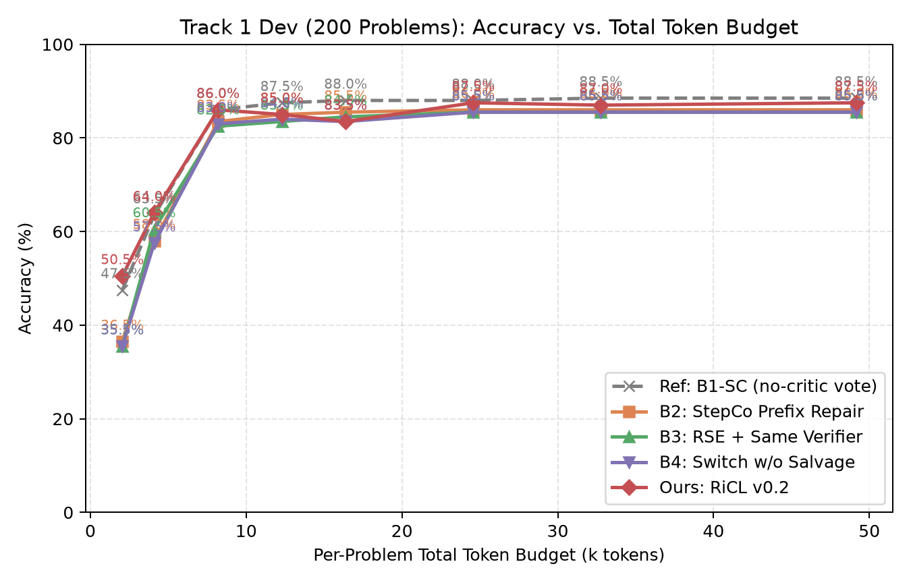
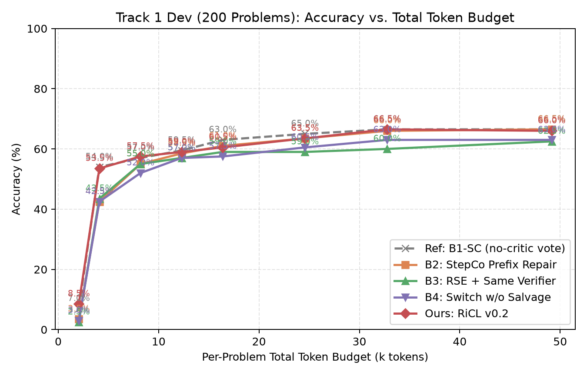

# Track 2 Confirmatory Report (`track2-frozen200`, Dual-Model Evaluation)

Confirmatory dual-model evaluation of **RiCL v0.2** against `B1-SC (N=3)`, `B2`, `B3`, and `B4` on the frozen 200-problem benchmark (`results/track2-frozen200/`).

## 1. Frozen Provenance & Experimental Setup

- **Runtime repository (`Challenge-Cup-2026`)**: `fe5f219a97b3464e0d4e2da52c588df02d4df30c`
- **Experiment repository execution commit (`RiCL_experiment`)**: `43bbc28d40f57de337b5a4d9932972359ab33bd0`
- **Archived dataset**: [`results/track2-frozen200/dataset/`](../results/track2-frozen200/dataset/manifest.json)
  - `schema_version` / `seed`: `track2-frozen200-v1`
  - `n_problems`: `200` (`math500`: `50`, `olympiadbench`: `50`, `omni_math`: `100`), `excluded_track1_qgids_count`: `52` (`0` overlap with Track 1 dev30 splits)
  - `problems_sha256`: `2e4285b985a6bd33976ebeab0a66bfc517e507a47e728b0118685a4ee8e7a56f`
  - `answer_key_sha256`: `4e7a2b8d458ecbad221f85d16cab3d214876252df7f943b7e7992503eba0271d`
- **Shared configuration**: `https://api.siliconflow.cn/v1`, `reasoning_effort=low`, `max_tokens=16384`, `token_limit=49152`, `request_limit=8`, `cost_limit_usd=0.25`, `token_caps=[2048, 4096, 8192, 12288, 16384, 24576, 32768, 49152]`, `0` runtime warnings across all stages.
- **Tracking issue**: [`RUSS0718/RiCL-experiemnt#35`](https://github.com/RUSS0718/RiCL-experiemnt/issues/35)

## 2. Audit Trail (`provider_error` Cleanup)

All original outputs were preserved before each selective retry of failed rollouts / `provider_error` runs (with zero edits to runtime code, prompts, evaluator, or dataset):

- **Initial pass (`max_workers=6`)**:
  - `DeepSeek-V4.1-Flash`: `3` failed `B1-SC` rollouts, `15` Phase C `provider_error` runs (`B2=3, B3=4, B4=4, RiCL_v0.2=4`) — archived in [`pre_provider_retry/`](../results/track2-frozen200/deepseek-v41-flash/pre_provider_retry/summary.json).
  - `Qwen/Qwen3-14B`: `13` failed `B1-SC` rollouts, `41` Phase C `provider_error` runs (`B2=2, B3=6, B4=21, RiCL_v0.2=12`) — archived in [`pre_provider_retry/`](../results/track2-frozen200/qwen3-14b/pre_provider_retry/summary.json).
- **Retry pass-1 (`max_workers=4`)**:
  - `DeepSeek-V4.1-Flash`: Phase C `provider_error` reduced `15 -> 0` (`RiCL_v0.2` solved `4/4`, jumping `85.5% -> 87.5%`); `B1-SC` failed rollouts reduced `3 -> 1`.
  - `Qwen/Qwen3-14B`: Phase C `provider_error` reduced `41 -> 3` (`B2=0, B3=0, B4=1, RiCL_v0.2=2`); `B1-SC` failed rollouts reduced `13 -> 1` — archived in [`pre_provider_retry_pass2/`](../results/track2-frozen200/qwen3-14b/pre_provider_retry_pass2/summary.json).
- **Retry pass-2 (`max_workers=2`, symmetric on remaining `Qwen/Qwen3-14B` failures)**:
  - Re-ran remaining `1` `B1-SC` rollout + `B4` (`1`) + `RiCL_v0.2` (`2`). Final state has **`0` Phase C `provider_error` across all 1,600 runs on both models** and **`0` failed `B1-SC` rollouts on `Qwen/Qwen3-14B`** (`1` failed `B1-SC` rollout on `DeepSeek-V4.1-Flash`).

## 3. Model 1: `deepseek-ai/DeepSeek-V4.1-Flash`

- **Artifacts**: [`summary.json`](../results/track2-frozen200/deepseek-v41-flash/summary.json) · [`records.jsonl`](../results/track2-frozen200/deepseek-v41-flash/records.jsonl) · [`curves.csv`](../results/track2-frozen200/deepseek-v41-flash/curves.csv) · [`b1sc_summary.json`](../results/track2-frozen200/deepseek-v41-flash/b1sc_summary.json)

### 3.1 Full-Budget (`49,152` tokens) Summary
- **`B1-SC (N=3)`**: `pass@1 = 86.0% (172/200)`, `maj@3 = 88.5% (177/200)`, `oracle@3 = 92.0% (184/200)`, `1,578,613` tokens, `$0.9007`.

| Condition | Pre-Retry Acc (`prov_err`) | Final Acc @ `49152` | MATH-500 L5 (`50`) | OlympiadBench (`50`) | Omni-MATH (`100`) | API Calls | Known Tokens | Est. USD | Pairwise (`RiCL` vs X @ `49k`) |
| --- | --- | --- | --- | --- | --- | --- | --- | --- | --- |
| `B1-SC (N=3)` | `88.0%` (`176/200`) | **`88.5%` (`177/200`)** | `49/50 (98.0%)` | **`47/50 (94.0%)`** | **`81/100 (81.0%)`** | — (`600` rollouts) | `1,578,613` | `$0.9007` | `Win=8, Loss=10 (Net -2)` |
| `B2` | `86.0%` (`172/200`, `3`) | `86.0%` (`172/200`) | `49/50 (98.0%)` | **`47/50 (94.0%)`** | `76/100 (76.0%)` | `806` | `1,782,857` | `$0.8730` | `Win=8, Loss=5 (Net +3)` |
| `B3` | `85.0%` (`170/200`, `4`) | `85.5%` (`171/200`) | **`50/50 (100.0%)`** | `46/50 (92.0%)` | `75/100 (75.0%)` | `796` | `1,459,665` | `$0.6821` | `Win=9, Loss=5 (Net +4)` |
| `B4` | `85.0%` (`170/200`, `4`) | `85.5%` (`171/200`) | `49/50 (98.0%)` | `46/50 (92.0%)` | `76/100 (76.0%)` | `760` | `1,714,974` | `$0.8594` | `Win=10, Loss=6 (Net +4)` |
| **`RiCL_v0.2`** | `85.5%` (`171/200`, `4`) | `87.5%` (`175/200`) | **`50/50 (100.0%)`** | **`47/50 (94.0%)`** | `78/100 (78.0%)` | **`604`** (fewest) | `1,674,120` | `$0.9141` | — |

### 3.2 `Accuracy vs. Total Tokens` Curve (`DeepSeek-V4.1-Flash`)
| Condition | `2048` | `4096` | `8192` | `12288` | `16384` | `24576` | `32768` | `49152` |
| --- | --- | --- | --- | --- | --- | --- | --- | --- |
| `B1-SC` | `47.5%` (`95`) | `63.5%` (`127`) | **`86.0%`** (`172`) | **`87.5%`** (`175`) | **`88.0%`** (`176`) | **`88.0%`** (`176`) | **`88.5%`** (`177`) | **`88.5%`** (`177`) |
| `B2` | `36.5%` (`73`) | `58.0%` (`116`) | `83.5%` (`167`) | `85.0%` (`170`) | `85.5%` (`171`) | `86.0%` (`172`) | `86.0%` (`172`) | `86.0%` (`172`) |
| `B3` | `35.5%` (`71`) | `60.5%` (`121`) | `82.5%` (`165`) | `83.5%` (`167`) | `84.5%` (`169`) | `85.5%` (`171`) | `85.5%` (`171`) | `85.5%` (`171`) |
| `B4` | `35.5%` (`71`) | `57.5%` (`115`) | `83.0%` (`166`) | `84.0%` (`168`) | `83.5%` (`167`) | `85.5%` (`171`) | `85.5%` (`171`) | `85.5%` (`171`) |
| **`RiCL_v0.2`** | **`50.5%`** (`101`) | **`64.0%`** (`128`) | **`86.0%`** (`172`) | `85.0%` (`170`) | `83.5%` (`167`) | `87.5%` (`175`) | `87.0%` (`174`) | `87.5%` (`175`) |

- **Mechanism telemetry**: `consensus_passed = 165/170 (97.1%)`, `local_empty_skip = 44`, `src_match = 394/465`, unique admitted = `101` (`2` `L1-Executable-Verified` + `99` `L2-Reviewed`), `nonempty_salvage = 11/27`, `cited>0 = 11/23`.

## 4. Model 2: `Qwen/Qwen3-14B`

- **Artifacts**: [`summary.json`](../results/track2-frozen200/qwen3-14b/summary.json) · [`records.jsonl`](../results/track2-frozen200/qwen3-14b/records.jsonl) · [`curves.csv`](../results/track2-frozen200/qwen3-14b/curves.csv) · [`b1sc_summary.json`](../results/track2-frozen200/qwen3-14b/b1sc_summary.json)

### 4.1 High-Budget (`32,768` & `49,152` tokens) Summary
- **`B1-SC (N=3)`**: `pass@1 = 58.0% (116/200)`, `maj@3 = 66.5% (133/200)`, `oracle@3 = 70.0% (140/200)`, `0` failed rollouts, `2,488,459` tokens, `$0.6725`.

| Condition | Pre-Retry Acc (`prov_err`) | Final Acc @ `32k` | Final Acc @ `49152` | MATH-500 L5 (`50`) | OlympiadBench (`50`) | Omni-MATH (`100`) | API Calls | Known Tokens | Est. USD | Pairwise (`RiCL` vs X @ `49k`) |
| --- | --- | --- | --- | --- | --- | --- | --- | --- | --- | --- |
| `B1-SC (N=3)` | `66.5%` (`133`) | **`66.5%` (`133`)** | **`66.5%` (`133/200`)** | `45/50 (90.0%)` | **`47/50 (94.0%)`** | `41/100 (41.0%)` | — (`600` rollouts) | `2,488,459` | `$0.6725` | `Win=8, Loss=9 (Net -1)` |
| `B2` | `66.5%` (`133`, `2`) | `66.0%` (`132`) | **`66.5%` (`133/200`)** | `44/50 (88.0%)` | `46/50 (92.0%)` | **`43/100 (43.0%)`** | `955` | `3,145,861` | `$0.5958` | `Win=9, Loss=10 (Net -1)` |
| `B3` | `60.5%` (`121`, `6`) | `60.0%` (`120`) | `62.5%` (`125/200`) | `46/50 (92.0%)` | `43/50 (86.0%)` | `36/100 (36.0%)` | `1,084` | `2,910,295` | `$0.5277` | `Win=17, Loss=10 (Net +7)` |
| `B4` | `62.0%` (`124`, `21`) | `63.0%` (`126`) | `63.0%` (`126/200`) | `46/50 (92.0%)` | `44/50 (88.0%)` | `36/100 (36.0%)` | `913` | `3,121,905` | `$0.6521` | `Win=13, Loss=7 (Net +6)` |
| **`RiCL_v0.2`** | `63.5%` (`127`, `12`) | **`66.5%` (`133`)** | `66.0%` (`132/200`) | **`47/50 (94.0%)`** | **`47/50 (94.0%)`** | `38/100 (38.0%)` | **`739`** (fewest) | `3,054,269` | `$0.6694` | — |

### 4.2 `Accuracy vs. Total Tokens` Curve (`Qwen/Qwen3-14B`)
| Condition | `2048` | `4096` | `8192` | `12288` | `16384` | `24576` | `32768` | `49152` |
| --- | --- | --- | --- | --- | --- | --- | --- | --- |
| `B1-SC` | `7.0%` (`14`) | **`54.0%`** (`108`) | `57.0%` (`114`) | **`59.5%`** (`119`) | **`63.0%`** (`126`) | **`65.0%`** (`130`) | **`66.5%`** (`133`) | **`66.5%`** (`133`) |
| `B2` | `3.5%` (`7`) | `42.5%` (`85`) | `55.0%` (`110`) | `58.5%` (`117`) | `61.0%` (`122`) | `63.5%` (`127`) | `66.0%` (`132`) | **`66.5%`** (`133`) |
| `B3` | `2.5%` (`5`) | `43.5%` (`87`) | `55.0%` (`110`) | `57.0%` (`114`) | `59.0%` (`118`) | `59.0%` (`118`) | `60.0%` (`120`) | `62.5%` (`125`) |
| `B4` | `3.0%` (`6`) | `42.5%` (`85`) | `52.0%` (`104`) | `57.0%` (`114`) | `57.5%` (`115`) | `60.5%` (`121`) | `63.0%` (`126`) | `63.0%` (`126`) |
| **`RiCL_v0.2`** | **`8.5%`** (`17`) | `53.5%` (`107`) | **`57.5%`** (`115`) | `59.0%` (`118`) | `60.5%` (`121`) | `63.5%` (`127`) | **`66.5%`** (`133`) | `66.0%` (`132`) |

- **Mechanism telemetry**: `consensus_passed = 118/131 (90.1%)`, `local_empty_skip = 2`, `src_match = 976/1109`, unique admitted = `514` (`8` `L1-Executable-Verified` + `506` `L2-Reviewed`), `nonempty_salvage = 20/70`, `cited>0 = 9/29`.

## 5. Cross-Model Findings & Limitations

1. **Multi-round accuracy & call efficiency**: With `provider_error = 0` across all 1,600 Phase C runs, `RiCL_v0.2` beats both cross-route baselines (`B3`, `B4`) on **both** models (`+2.0` pts on DeepSeek, `+3.5/+3.0` pts on Qwen3-14B), beats `B2` on DeepSeek (`87.5%` vs `86.0%`, `+3` net) while tying/leading at `32k` on Qwen3-14B (`66.5%` vs `66.0%`) and matching within `1` problem at `49k` (`66.0%` vs `66.5%`), all while requiring **`19%–32%` fewer API calls** (`604` vs `760–806`; `739` vs `913–1,084`).
2. **Tight-budget & `MATH-500 L5` / `OlympiadBench` strength**: `RiCL_v0.2` leads at `2048` tokens on both models (`50.5%` DeepSeek, `8.5%` Qwen3-14B) and achieves the highest or tied-highest accuracy on `MATH-500 L5` (`100.0%`, `94.0%`) and `OlympiadBench` (`94.0%`, `94.0%`).
3. **Open limitations**: On `Qwen3-14B` (`reasoning_effort=low`), `consensus_passed` false-positive rate increases from `2.9%` (`5/170`, DeepSeek) to `9.9%` (`13/131`), and on the hardest `Omni-MATH` subset `B2` (`43/100`) and `B1-SC (N=3)` (`41/100`) remain slightly ahead of `RiCL_v0.2` (`38/100`).
